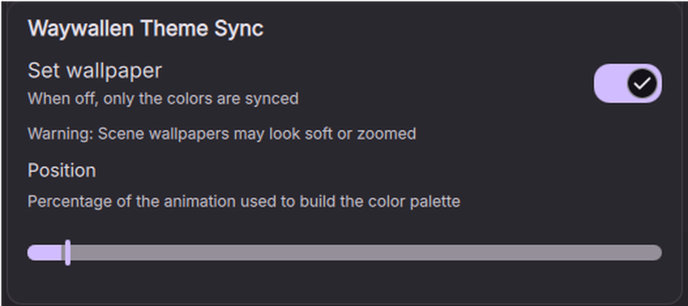

# Waywallen Theme Sync

A [DankMaterialShell](https://danklinux.com) plugin that keeps your DMS colors in
sync with the wallpaper currently playing in [Waywallen](https://github.com/waywallen/waywallen).

It reads Waywallen's active wallpaper, extracts a frame at a position you choose,
and either uses that frame as the DMS wallpaper (which makes DMS generate the
palette from it) or only updates the palette and leaves your wallpaper alone.



## Requirements

- DankMaterialShell 1.6.0 or newer
- Waywallen with its database at `~/.local/share/waywallen/waywallen-v2.db`
- `ffmpeg` and `ffprobe`
- `sqlite3`

On Arch:

```bash
sudo pacman -S ffmpeg sqlite
```

On Debian:

```bash
sudo apt install ffmpeg sqlite3
```

On Fedora:

```bash
sudo dnf install ffmpeg sqlite3
```

If either tool is missing the plugin refuses to enable and tells you what to
install.

## Install

Copy the `waywallenTheme` folder into your DMS plugin directory:

```bash
git clone https://github.com/Douzend/dms-waywallen-theme.git
cp -r dms-waywallen-theme ~/.config/DankMaterialShell/plugins/waywallenTheme
```

Then open **Settings → Plugins**, find *Waywallen Theme Sync* and enable it.
Reload an already installed copy with:

```bash
dms ipc call plugin-scan reload waywallenTheme
```

## Settings

| Setting | Default | What it does |
|---|---|---|
| **Set wallpaper** | off | Also replaces the DMS wallpaper with the extracted frame. Turn it off to sync only the colors and keep your current wallpaper. |
| **Position** | 5 % | Where in the animation the frame is sampled. Only used when the source has a duration (videos and GIFs). |

## How it works

1. Watches `~/.config/waywallen/config.toml` (plus a 3 s poll, because Waywallen
   rewrites the file atomically and `inotify` watches stop working).
2. Reads the wallpaper id from `last_wallpaper` and looks it up in Waywallen's
   SQLite database.
3. Extracts a frame with `ffmpeg` at `duration × position`. Videos use their
   `.mp4`; images use the file itself; scenes use their Steam preview.
4. Either calls `dms ipc call wallpaper set <frame>` or `Theme.setDesiredTheme()`,
   depending on the **Set wallpaper** toggle.
5. Crops the frame to your monitor resolution and keeps only the frame in use.

Frames are cached in `~/.cache/waywallen-theme/`.

## Limitations

- **Scenes may look soft.** Wallpaper Engine scenes are stored in a proprietary
  `scene.pkg`, so the plugin can only use the preview Steam ships (250×250 to
  1080×1080, usually square). That preview is upscaled and cropped to your screen.
  Videos and images are always extracted at full resolution.
- **Primary monitor only.** The plugin uses the first screen reported by
  Quickshell and DMS's global wallpaper, not Waywallen's per-display settings.
- **Single wallpaper to sample.** It follows the global `last_wallpaper` value,
  so switching wallpapers on a secondary display has no effect on the palette.
- The palette reflects the sampled instant, not the whole animation. A scene that
  changes color over time can produce different colors at different positions.

## Troubleshooting

```bash
# See what the plugin is doing
journalctl --user -u dms -f | grep -i waywallen

# Force a re-sync
dms ipc call waywallenTheme sync

# Check the cache and its dimensions
ls -l ~/.cache/waywallen-theme/
ffprobe -v error -show_entries stream=width,height -of csv=p=0 ~/.cache/waywallen-theme/*.png
```

## License

[PolyForm Noncommercial 1.0.0](LICENSE).

You may use, modify and share this plugin for any noncommercial purpose,
including personal use, study, hobby projects and noncommercial organizations.
Selling it, or using it as part of a commercial product or service, is not
allowed.

This is a source-available license, not an OSI-approved open source license.
